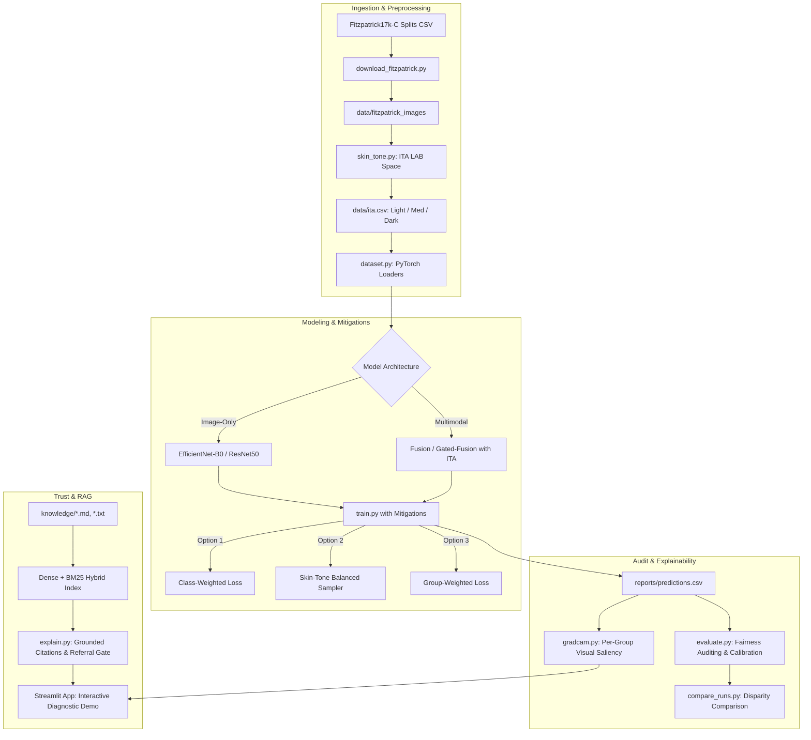

# Vishwas: Skin-Tone-Aware Skin Disease Classification with Fairness Auditing and Retrieval-Grounded Explanations

**Vishwas** (विश्वास, meaning *Trust / Confidence*) is an end-to-end trustworthy dermatological AI system engineered from scratch. It is designed to address algorithmic bias and misdiagnosis disparities across varied skin tones (Fitzpatrick Skin Phototypes I through VI) using the cleaned **Fitzpatrick17k-C** dataset.

---

## Architecture Overview



---

## Directory Structure

```text
vishwas/
├── configs/
│   └── config.yaml              # Global project settings and hyperparameters
├── src/
│   ├── ingest/
│   │   └── download_fitzpatrick.py  # Multi-threaded image downloader with PIL validation
│   ├── preprocess/
│   │   ├── skin_tone.py         # LAB Individual Typology Angle (ITA) extraction
│   │   └── dataset.py           # Color-preserving & standard PyTorch datasets
│   ├── models/                  # Image backbones, Multimodal and Gated-Fusion heads
│   ├── train/                   # Training loop with bias mitigations and MPS acceleration
│   ├── fairness/                # Fairness metrics (ECE, ROC-AUC gap, F1 gap, bootstrap CIs)
│   ├── explain/                 # Grad-CAM overlays per skin-tone group
│   ├── rag/                     # Hybrid BM25+FAISS retrieval with grounded explanations
│   └── app/                     # Streamlit clinical diagnosis and auditing dashboard
├── reports/                     # Model checkpoints, evaluation summaries, and disparity charts
├── knowledge/                   # Clinical guideline references for grounded RAG
├── tests/                       # Unit tests (partition leakage, ITA, fairness metrics)
├── Makefile                     # Execution targets
├── requirements.txt             # Project dependencies
└── README.md                    # System documentation
```

---

## Quickstart & Commands

```bash
# 1. Ingest & Download Sample (Phase 1)
make download           # Downloads first 50 images with verification

# 2. Run Partition Leakage Tests
make test               # Verifies train/val/test disjointness and zero leakage

# 3. Full Ingest (Once Phase 1 confirmed)
make download LIMIT=all

# 4. Skin Tone & ITA Extraction (Phase 2)
make ita

# 5. Train Model with Mitigations (Phase 3)
make train

# 6. Audit Fairness Across Skin Tones (Phase 4)
make evaluate

# 7. Generate Explainability Visuals (Phase 5)
make gradcam

# 8. Index Clinical Knowledge for RAG (Phase 6)
make rag-index

# 9. Launch Clinical Interactive App (Phase 7)
make app
```
